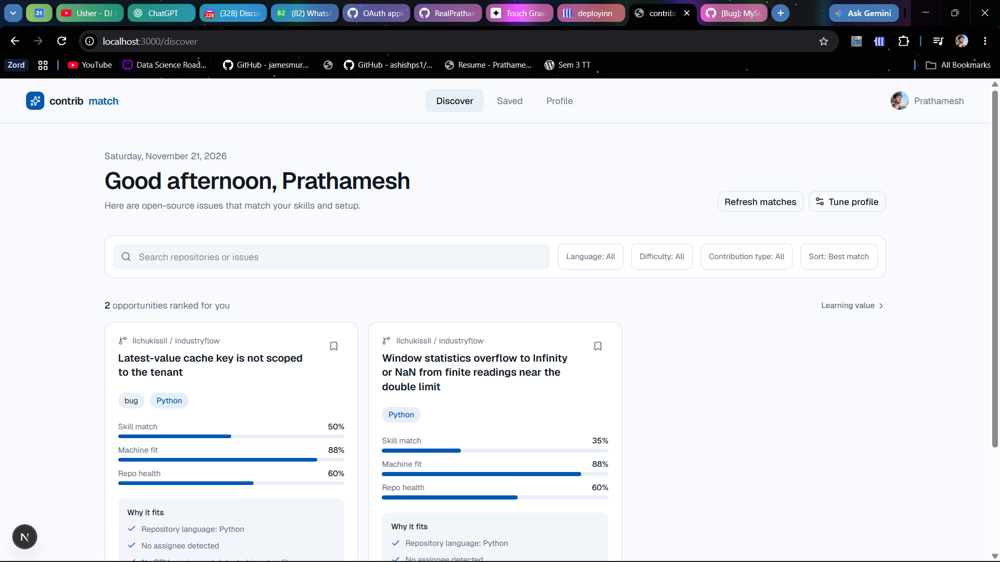
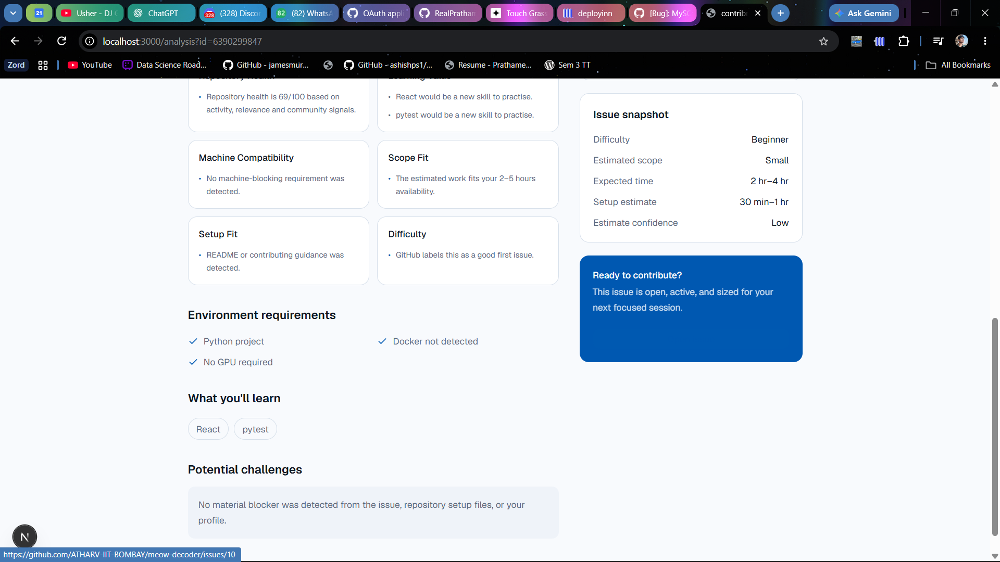
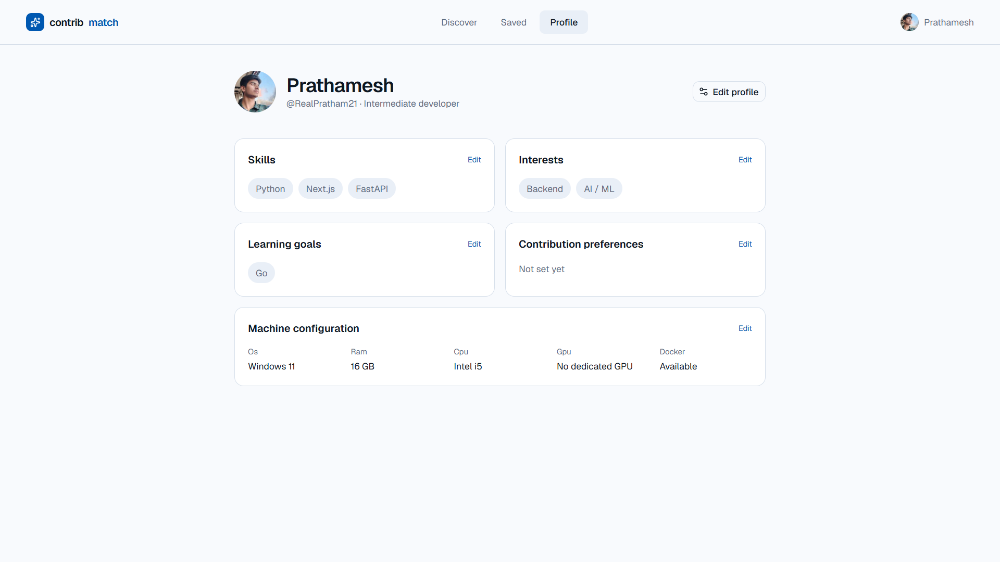

# contribmatch

**Find an open-source issue you can realistically ship—and understand why it fits you.**

contribmatch combines a developer profile, live GitHub issue data, repository setup signals, deterministic scoring, and an optional Cohere-generated contributor brief. It recommends concrete issues instead of returning an unranked list of `good first issue` labels.

**[Open the live app](https://open-source-match-maker-2.deployinn.com)** · [Local setup](#local-development) · [Production setup](#production-setup) · [Environment variables](#environment-variables)

> The hosted deployment uses Deployinn for the Next.js app and Supabase Cloud for GitHub authentication, PostgreSQL, the Data API, and row-level security.



## Product tour

| Issue analysis | Developer profile |
| --- | --- |
|  |  |

## What it does

1. Authenticates the developer with GitHub through Supabase Auth.
2. Persists a profile containing skills, interests, contribution preferences, available time, and machine capabilities.
3. Searches active public repositories and open issues using the GitHub REST API.
4. Rejects assigned, stale, underspecified, tracker/meta, and language-incompatible issues.
5. Enriches candidates with repository manifests, setup files, recent comments, health, and machine requirements.
6. Ranks a diverse set of issues and explains every score with deterministic evidence.
7. Persists discovery runs, recommendations, and saved/dismissed issue state per user.
8. Builds a structured contributor brief from the issue, repository documentation, discussion, and user profile. Cohere upgrades the evidence-based fallback when configured.

### Matching signals

- Existing languages and technologies
- Learning goals and contribution preferences
- Issue labels, description quality, recency, assignment, and claim comments
- Repository activity, community signals, and setup documentation
- Docker, infrastructure, GPU, operating-system, and memory compatibility
- Estimated setup time, implementation time, scope, difficulty, and learning value

### Contributor brief

The analysis page separates deterministic matching from the optional AI brief. The brief uses a strict, versioned schema covering:

- concrete objective and issue type;
- whether the issue is actionable or needs scoping;
- personalised fit and prerequisites;
- repository-grounded setup steps and commands;
- an ordered implementation approach;
- validation checks, risks, gaps, and evidence used.

Commands are only included when they appear in the supplied repository documentation. Tracker and roadmap issues are identified instead of being presented as ordinary implementation tasks.

## Architecture

```text
GitHub OAuth ──> Supabase Auth ──> profile + RLS-protected user data
                                           │
GitHub REST API ──> discovery/filtering ──> deterministic assessment
                                           │
Repository docs + issue discussion ────────┼──> contributor brief
                                           │       ├─ local fallback
                                           │       └─ Cohere Command A
                                           │
                                           └──> Discover / Saved / Analysis
```

| Layer | Technology |
| --- | --- |
| Application | Next.js 16, React 19, TypeScript |
| UI | Tailwind CSS, Base UI, shadcn-style components, Lucide icons |
| Auth and data | Supabase Auth, PostgreSQL, Data API, RLS |
| GitHub integration | Octokit and the GitHub REST API |
| AI brief | Cohere Command A (`command-a-03-2025` by default) |
| Testing | Vitest and TypeScript |
| Hosting | Deployinn + Supabase Cloud |

## Project layout

```text
.
├── frontend/
│   ├── app/                    # App Router pages, auth callback, and API routes
│   ├── components/             # Product UI and client-side providers
│   └── lib/
│       ├── cohere/             # Strict contributor-brief generation
│       ├── github/             # Discovery, filtering, scoring, and assessment
│       ├── persistence/        # Runs, recommendations, and saved issue state
│       └── supabase/           # Browser/server clients and generated types
├── screenshots/
└── supabase/
    ├── config.toml             # Local Supabase configuration
    └── migrations/             # Reproducible schema, grants, RLS, and policies
```

## Environment variables

Copy `frontend/.env.example` to `frontend/.env.local`. Do not quote values and never commit the local file.

```env
NEXT_PUBLIC_SUPABASE_URL=https://YOUR_PROJECT_REF.supabase.co
NEXT_PUBLIC_SUPABASE_PUBLISHABLE_KEY=sb_publishable_...

GITHUB_TOKEN=github_pat_or_classic_pat

# Optional: the deterministic contributor brief works without Cohere.
COHERE_API_KEY=
# COHERE_MODEL=command-a-03-2025
```

| Variable | Required | Purpose |
| --- | --- | --- |
| `NEXT_PUBLIC_SUPABASE_URL` | Yes | Supabase project API URL. For local development use the API URL reported by `supabase status`. |
| `NEXT_PUBLIC_SUPABASE_PUBLISHABLE_KEY` | Yes | Browser-safe Supabase publishable key. A legacy anon key may instead be supplied as `NEXT_PUBLIC_SUPABASE_ANON_KEY`. |
| `GITHUB_TOKEN` | Yes for useful discovery | Server-only token used for GitHub search and issue/repository reads. A classic PAT with no scopes is sufficient for broad public-repository discovery. |
| `COHERE_API_KEY` | No | Server-only key that upgrades the deterministic contributor brief. |
| `COHERE_MODEL` | No | Optional model override; defaults to `command-a-03-2025`. |

Only the Supabase URL and **publishable/anon** key belong in `NEXT_PUBLIC_*`. Never expose a Supabase secret or `service_role` key, a GitHub token, or a Cohere key to browser code.

## Local development

### Prerequisites

- Node.js 22+
- npm
- Docker Desktop, when using the local Supabase stack
- A GitHub OAuth App for GitHub sign-in

### 1. Install the frontend

```bash
git clone https://github.com/RealPratham21/Open-Source-Match-Maker.git
cd Open-Source-Match-Maker/frontend
npm ci
```

### 2. Start Supabase locally

From the repository root:

```bash
npx supabase start
```

The CLI applies every file in `supabase/migrations/`. Copy the reported API URL and anon key into `frontend/.env.local`.

Local GitHub OAuth also requires these values in a repository-root `.env` file because `supabase/config.toml` reads them when the stack starts:

```env
SUPABASE_AUTH_GITHUB_CLIENT_ID=
SUPABASE_AUTH_GITHUB_SECRET=
```

Configure the local GitHub OAuth App with:

- Homepage URL: `http://localhost:3000`
- Authorization callback URL: `http://localhost:54321/auth/v1/callback`

Restart the local Supabase stack after changing provider variables:

```bash
npx supabase stop
npx supabase start
```

### 3. Start Next.js

```bash
cd frontend
npm run dev
```

Open [http://localhost:3000](http://localhost:3000), sign in with GitHub, complete onboarding, and refresh Discover.

## Production setup

### Supabase Cloud

Create a hosted Supabase project, then link and push the checked-in migrations. Supabase CLI v3 targets local by default, so keep the remote flag explicit:

```bash
npx supabase login
npx supabase link --project-ref YOUR_PROJECT_REF
npx supabase db push --remote
```

The migrations create the profile, GitHub cache, persistence, and recommendation tables; enable RLS; add ownership policies; and grant the authenticated role the required table operations. Keep the `public` schema exposed in the project Data API settings.

Configure **Authentication → Providers → GitHub** using a production GitHub OAuth App:

- Homepage URL: `https://open-source-match-maker-2.deployinn.com`
- GitHub callback URL: `https://YOUR_PROJECT_REF.supabase.co/auth/v1/callback`

Configure **Authentication → URL Configuration**:

- Site URL: `https://open-source-match-maker-2.deployinn.com`
- Redirect URL: `https://open-source-match-maker-2.deployinn.com/auth/callback`

### Deployinn

The current deployment is available at **[open-source-match-maker-2.deployinn.com](https://open-source-match-maker-2.deployinn.com)**.

Add the following variables in the Deployinn project’s **Variables** tab, then redeploy:

```text
NEXT_PUBLIC_SUPABASE_URL
NEXT_PUBLIC_SUPABASE_PUBLISHABLE_KEY
GITHUB_TOKEN
COHERE_API_KEY              # optional
COHERE_MODEL                # optional
```

The application passes the browser-safe Supabase configuration from the Next.js server at runtime. This avoids relying on a hosting provider to inline `NEXT_PUBLIC_*` values during its build while keeping all server-only credentials private.

## Verification

```bash
cd frontend
npm test
npx tsc --noEmit
```

The current suite covers deterministic assessment, discovery diversity, structured brief parsing, and tracker/meta-issue handling.

## Security notes

- Every user-owned table has RLS enabled and ownership checks based on `auth.uid()`.
- Recommendation rows must belong to a discovery run owned by the same user.
- Supabase secret and service-role keys are not used by the frontend.
- GitHub and Cohere credentials are consumed only by server routes.
- Repository and issue text is treated as untrusted input before it reaches Cohere.
- `.env`, `.env.local`, Supabase temporary state, dependencies, and build output are ignored by Git.

## License

MIT. See [LICENSE](LICENSE).
