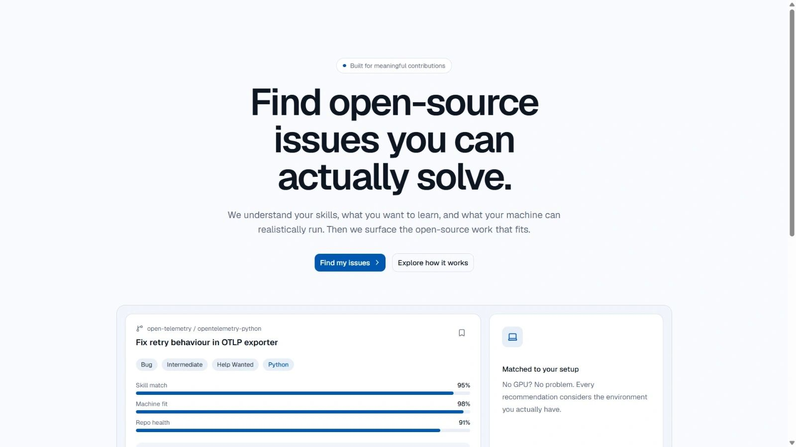
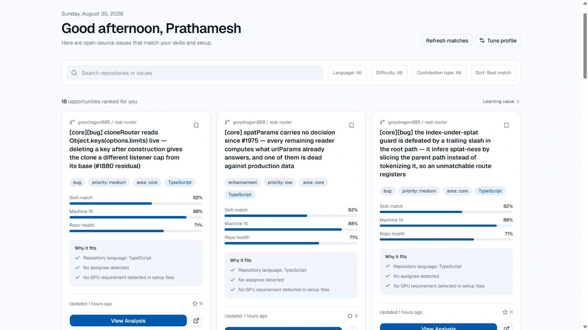

# contribmatch

**Find the next open-source issue you can actually ship — and understand why it fits you.**

contribmatch is a “LeetCode for open source” web app. It matches developers to **specific GitHub issues** they can realistically contribute to, using their skills, goals, and machine — not a dump of `good first issue` labels, and not a chatbot for GitHub.

> Which open-source issue should I work on next, and why is it a good fit for me?

Built over a weekend for **[Cursor Cafe](https://cursor.com) in Pune** on **29 August 2026**.

[Getting started](#getting-started) · [How it works](#how-it-works) · [What’s implemented](#whats-implemented)

---

## Product

Open source is full of work. Most of it is a poor match for a given developer.

GitHub search ignores the things that actually decide whether you can contribute: your stack, how much time you have, whether the issue is already claimed, whether the repo is alive, how painful setup is, and whether your machine can run the project.

contribmatch ranks **issues** against a **developer profile** (including hardware), then shows scores and a short “why this fits.”



*Landing — the promise is a realistic next contribution, not another issue feed.*



*Discover — live GitHub issues, ranked with skill match, machine fit, and repository health.*

---

## How it works

1. Sign in with **GitHub** (Supabase Auth).
2. Build a **developer profile** (skills, interests, time, machine).
3. The backend **discovers** public repositories and open issues via the GitHub REST API (Octokit).
4. Deterministic filters drop assigned, stale, empty, or obviously unsuitable issues.
5. You get a ranked list on **Discover**, with Saved, Profile, and a per-issue analysis view.

### Developer profile

| Area | Examples |
| --- | --- |
| Skills | Languages and technologies you already use |
| Experience | Beginner, intermediate, challenging |
| Interests | Backend, AI/ML, developer tools, infrastructure |
| Learning goals | What you want to pick up next |
| Contribution types | Bug fixes, small features, docs, tests, performance |
| Difficulty & time | Preferred difficulty and hours you can spend |
| Machine | OS, RAM, CPU, GPU, Docker |

### Ranking signals (deterministic, this weekend)

- Skill / language / tech match  
- Repository activity and health  
- Issue recency, labels, and description quality  
- Assignee / simple “already claimed” comment heuristics  
- Setup files (Docker, GPU/CUDA mentions, language manifests)  
- Machine compatibility (e.g. no GPU vs CUDA-heavy repos)

### Intended full pipeline

```
GitHub discovery
    → deterministic filtering
    → Cohere semantic rerank      ← not in this weekend build
    → deeper analysis
    → personalised scoring
    → ranked recommendations + explanations
```

This repo implements discovery through **candidate enrichment**. Semantic rerank and AI write-ups are the next step.

---

## What’s implemented

| Area | Status |
| --- | --- |
| Next.js UI (landing, sign-in, onboarding, Discover, Saved, Profile, analysis) | Done |
| GitHub OAuth via Supabase | Done |
| Profile persistence (PostgreSQL + RLS) | Done |
| Octokit repo + issue discovery | Done |
| Setup-file / machine-fit heuristics | Done |
| GitHub metadata cache in Supabase | Done |
| Cohere Rerank / Command | Not yet |
| AI “why it fits” copy | Placeholder until Cohere |

---

## Stack

| Layer | Choice |
| --- | --- |
| App | Next.js 16, React 19, TypeScript |
| UI | Tailwind CSS, shadcn/ui |
| Auth & database | Supabase (GitHub OAuth + Postgres) |
| GitHub | REST API via Octokit (server-side, public data only) |
| Planned ranking | Cohere Rerank + Command |
| Hosting | Vercel (app), Supabase (auth + DB) |

---

## Project layout

```
.
├── README.md
├── LICENSE
├── screenshots/                 # Product shots
├── supabase/migrations/         # SQL to apply in the dashboard
└── frontend/                    # Next.js app
    ├── app/                     # Routes, auth callback, API
    ├── components/
    └── lib/
        ├── supabase/            # Browser + server clients
        └── github/              # Discovery engine (Octokit)
```

---

## Getting started

You need **Node.js 20+** and npm.

### 1. Clone and install

```bash
git clone https://github.com/RealPratham21/Open-Source-Match-Maker.git
cd Open-Source-Match-Maker/frontend
npm install
```

### 2. Environment

Copy `frontend/.env.example` to `frontend/.env.local`:

```env
NEXT_PUBLIC_SUPABASE_URL=https://YOUR_PROJECT.supabase.co
NEXT_PUBLIC_SUPABASE_PUBLISHABLE_KEY=
GITHUB_TOKEN=
```

| Variable | Where to get it |
| --- | --- |
| `NEXT_PUBLIC_SUPABASE_URL` | Supabase → Project Settings → API |
| `NEXT_PUBLIC_SUPABASE_PUBLISHABLE_KEY` | Same page (or legacy **anon** key as `NEXT_PUBLIC_SUPABASE_ANON_KEY`) |
| `GITHUB_TOKEN` | GitHub → Settings → Developer settings → Personal access tokens → **classic**, no `repo` scope |

Never commit `.env.local`. Never use a Supabase **service role** key in the frontend.

### 3. Supabase dashboard

1. **Authentication → Providers → GitHub** — Client ID and secret from a GitHub OAuth App.  
   GitHub callback URL: `https://YOUR_PROJECT.supabase.co/auth/v1/callback`
2. **Authentication → URL configuration**  
   Site URL: `http://localhost:3000`  
   Redirect URLs: `http://localhost:3000/auth/callback`
3. **SQL Editor** — run both files in `supabase/migrations/` (profiles, then GitHub cache).

### 4. Run

```bash
npm run dev
```

Open [http://localhost:3000](http://localhost:3000) → **Find my issues** → GitHub sign-in → onboarding → **Discover**.

---

## Discovery API

Authenticated `POST /api/discover` loads the signed-in user’s profile from Postgres (or a safe fallback if the table is empty), searches public GitHub, filters issues, and returns `CandidateIssue[]` ready for a future Cohere rerank step.

Server logs look like:

```
[discovery] profile loaded
[discovery] generated repository queries
[discovery] unique repositories
[discovery] repositories shortlisted
[discovery] open issues fetched
[discovery] issues survived filtering
[discovery] candidates enriched
```

---

## License

MIT. See [LICENSE](LICENSE).
